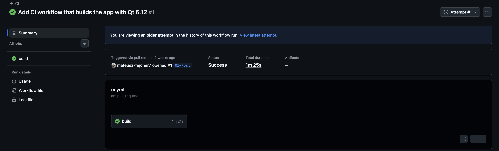
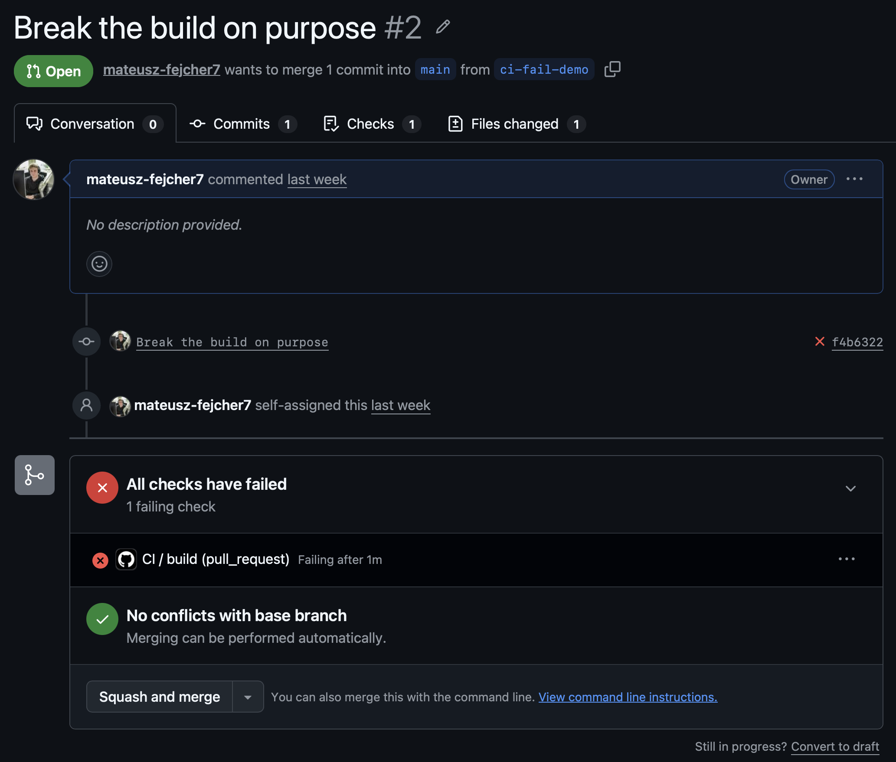
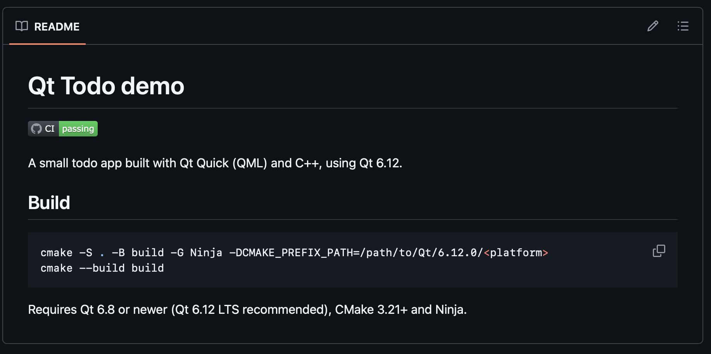

Your new colleague hands most of their work to AI. Or maybe they're a junior who is still learning the codebase. Either way, their PR lands in your review queue.

You start reading. The code looks clean and the logic makes sense. Then you check out the branch to try it, and it doesn't even build. A leftover test path points at a folder that only exists on their laptop. You write to them, and the reply comes back: "it works on my machine."

It's a trivial mistake, but it cost you your flow. You switched from your own work into review mode, and now you have to switch again to send it back. With AI writing code faster than anyone can read it, this will happen more often, and the first question of every review stays the same: does it even build?

A machine can answer that before you open the PR. It's called CI - continuous integration. It helps you and your team catch build problems sooner, and it saves frustration, time and money.

Here I'll show you how to set up GitHub Actions for a Qt app, so every push and every PR is built automatically on a clean machine. A PR that doesn't build gets a red status before anyone starts reviewing it.

## What CI (and CD) mean

Before we build anything, let's get two terms straight, because they get mixed up a lot. You will usually see them written together as CI/CD, but they are two different things, and both are part of a bigger picture.

**CI (continuous integration)** means every change is built automatically, on a clean machine, as soon as it is pushed. Later in this series the same step will also run tests.

**CD (continuous delivery)** is the next part of that picture: delivering the result automatically, as a package, an installer or a release. That is a topic for another post.

```
push  ->  runner (clean machine)  ->  build  ->  green or red check
```

This is what makes it so convenient: you no longer have to rely on a promise like "it works on my machine". A neutral, fresh machine that builds the change from scratch gives you a fact - a green check means the same thing for everyone on the team.

## The demo app

CI needs an application to build, so I created a small and simple todo app.

<video controls autoplay loop muted playsinline width="100%" style="max-width:360px">
  <source src="/assets/images/ci-cd/todoapp.mp4" type="video/mp4">
</video>

You type a task, press Add, tick it off, or delete it. It is small on purpose, so the post stays about CI. It still has a C++ model behind the QML interface, which gives it a taste of a real product application, not only a mock.

```
qt-cicd-demo/
├── CMakeLists.txt
├── qml/
│   ├── Main.qml
│   └── TodoDelegate.qml
└── src/
    ├── main.cpp
    ├── todomodel.cpp
    └── todomodel.h
```

To build it locally you need Qt 6.8 or newer (I use 6.12 LTS), CMake 3.21+ and Ninja:

```sh
cmake -S . -B build -G Ninja -DCMAKE_PREFIX_PATH=/path/to/Qt/6.12/<platform>
cmake --build build
```

The code for this post is in the [qt-cicd-demo](https://github.com/mateusz-fejcher7/qt-cicd-demo) repository, at the tag `01-first-ci-build`.

## GitHub Actions

To show CI in practice, I use GitHub Actions. It is built into GitHub and free for public repositories. It is only one of many CI systems, and the idea is the same everywhere, so if your code lives somewhere else, look up how it works there.

In GitHub Actions you describe what should happen in a YAML file inside your repository, in the folder `.github/workflows/`, and GitHub does the rest. Six words are enough to follow along:

- **Event:** something that happens in the repo, like a push or a new PR.
- **Workflow:** one YAML file. It says which events start it and what to do.
- **Job:** a group of steps that run together on one machine. A workflow has one or more jobs.
- **Runner:** the machine that runs a job. GitHub gives you a fresh virtual machine and throws it away afterwards.
- **Step:** one command or one action, run in order. If a step fails, the job stops and shows a red status.
- **Action:** a reusable step written by someone else, like checking out your code.

The runner starts empty every time. It has no Qt, no source code and no build folder, so the workflow has to set everything up. That is exactly why it is such a good check.

## Building the workflow, step by step

Now that you know the vocabulary, let's use it. Our workflow does what you would do by hand on a brand new computer: get the code, install Qt, and build. Create the file `.github/workflows/ci.yml` in your repository. I'll build it up one block at a time, and the full file is at the end.

### 1. Name and triggers

```yaml
name: CI

on:
  push:
    branches: [main]
  pull_request:
  workflow_dispatch:
```

`name` is what you see in the Actions tab. `on` lists the events that start the workflow:

- **push to `main`** builds the main branch after every merge.
- **pull_request** builds every PR, and builds again on every commit pushed to it, so you see the result before you review.
- **workflow_dispatch** adds a manual "Run workflow" button.

### 2. Job and runner

```yaml
jobs:
  build:
    runs-on: ubuntu-24.04
```

One job called `build`, running on a hosted Ubuntu 24.04 machine. I pin the exact version instead of `ubuntu-latest`, so GitHub can't change the OS under me.

### 3. Check out the code

```yaml
    steps:
      - name: Check out the code
        uses: actions/checkout@v5
```

The runner starts empty, so the first step copies your repository onto it. For a PR, it checks out the result of merging the PR into `main`, which is what you actually want to test.

### 4. Install Qt

```yaml
      - name: Install Qt
        uses: jurplel/install-qt-action@v4
        with:
          version: "6.12.0"
          cache: true
```

This action downloads a prebuilt Qt, so nothing is compiled from source. Two lines matter:

- **`version: "6.12.0"`** is pinned to the exact version I use locally. CI has to match what you ship.
- **`cache: true`** saves the downloaded Qt, so later runs restore it instead of downloading it again. The first run is slower because the cache is empty. On my runs it cut the total time from 1m 25s to 1m 2s, about 23 seconds. Nice to know, but on a small app it is not a big difference.

### 5. System packages

```yaml
      - name: Install build tools
        run: |
          sudo apt-get update
          sudo apt-get install -y ninja-build libgl1-mesa-dev libxkbcommon-dev
```

A bare runner has no Ninja, and Qt Quick needs the OpenGL and xkbcommon development headers to link. The Qt action installs the two libraries as well, but I list them here so the requirements are visible in the file.

### 6. Configure and build

```yaml
      - name: Configure
        run: cmake -S . -B build -G Ninja -DCMAKE_BUILD_TYPE=Release

      - name: Build
        run: cmake --build build
```

The same two commands as on my machine. There is no `CMAKE_PREFIX_PATH` here, because the Qt action sets up the environment so that CMake finds Qt on its own.

### The full file

```yaml
name: CI

on:
  push:
    branches: [main]
  pull_request:
  workflow_dispatch:

jobs:
  build:
    runs-on: ubuntu-24.04

    steps:
      - name: Check out the code
        uses: actions/checkout@v5

      - name: Install Qt
        uses: jurplel/install-qt-action@v4
        with:
          version: "6.12.0"
          cache: true

      - name: Install build tools
        run: |
          sudo apt-get update
          sudo apt-get install -y ninja-build libgl1-mesa-dev libxkbcommon-dev

      - name: Configure
        run: cmake -S . -B build -G Ninja -DCMAKE_BUILD_TYPE=Release

      - name: Build
        run: cmake --build build
```

## Watching CI run

### A green run

I committed the workflow on a branch, pushed it and opened a PR. Because `ci.yml` listens to `pull_request`, the run started on its own. Open the **Actions** tab of your repository to watch it.



Click the run, then the `build` job. Every step from the YAML shows up as its own row, with its own log and its own time. Open the **Check out the code** step and you will see the PR being checked out as a merge with `main`, like I described above.

### A red run, on purpose

A CI that has never failed is hard to trust, so now I break the build on purpose. On a new branch I add a typo in `src/main.cpp`: `QGuiApplication` becomes `QGuiApplicatio`. Then I push it and open a PR.

The run turns red. The PR page shows the failing check right next to the commit, before anyone has read a line of code.



To see why it failed, click the `build` job and open the **Build** step:

<video controls autoplay loop muted playsinline width="100%" style="max-width:900px">
  <source src="/assets/images/ci-cd/failed-build.mp4" type="video/mp4">
</video>

The compiler error is the same one you would see on your own machine:

```
src/main.cpp:6:5: error: 'QGuiApplicatio' was not declared in this scope; did you mean 'QGuiApplication'?
```

Then I fix the typo and push again. Another run starts on the new commit and turns green. This is the moment CI makes sense: nobody had to promise anything, the machine said it.

## The build badge

One more small thing. GitHub can give you a badge that shows the current state of the workflow, and you can put it at the top of the README. Anyone who opens the repository sees right away whether `main` builds.

Add this line to the README:

```markdown
[](https://github.com/mateusz-fejcher7/qt-cicd-demo/actions/workflows/ci.yml)
```

The URL is built from your username, the repository name and the workflow file name (`ci.yml`). By default the badge shows the latest run on the default branch, and clicking it opens the workflow's runs.



## This is only a starting point

This setup does its job: a build that is broken gets caught on a clean machine. There are still a few loose ends:

- Qt is restored or downloaded on every run, and as you saw, the cache saves only a little time.
- The runner image belongs to GitHub, not to you. It gets updates you don't control, and the apt packages are whatever Ubuntu offers that day.
- Actions like `actions/checkout@v5` are referenced by a version tag, which the author can move.

For a small app and a first pipeline this is fine. To get better control over the build environment, the usual answer is Docker, but I skipped it here to avoid too much information in one post.

## Recap

As you can see, CI is a powerful tool. It tells you a PR is broken before you spend time reviewing it, and before the author thinks it is done. It does not matter if the code comes from a senior, a junior or an AI tool.

In my opinion it matters more now than before. I see more and more companies eager to generate code with AI. Writing code gets cheaper, but checking that it works is more important than ever. So when AI is an option, CI should be **crucial** and **well designed**.

The code for this post is in the [qt-cicd-demo](https://github.com/mateusz-fejcher7/qt-cicd-demo) repository, at the tag `01-first-ci-build`.