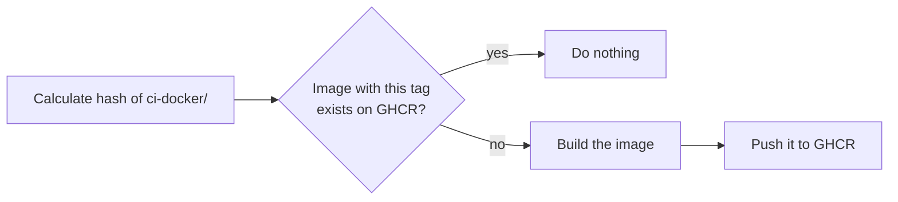
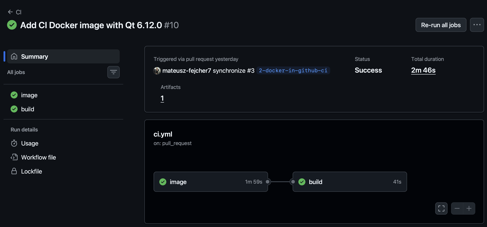
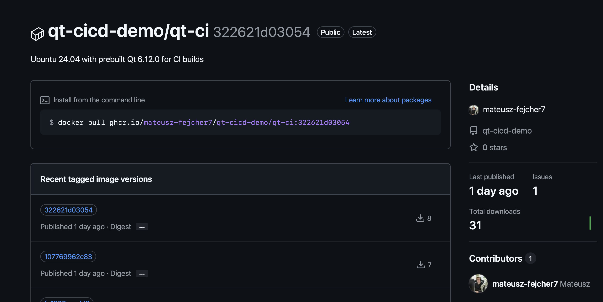
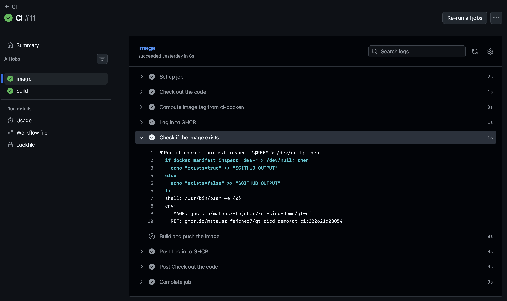

Green on Friday. Red on Monday. Nobody touched the code.

The log says CMake can't find a library that was there last week. What changed is the machine. GitHub updated the runner image over the weekend, and an apt package moved with it. Now you spend your morning debugging a machine you don't own, instead of your app.

In the [previous post](/posts/your-first-ci-pipeline-for-a-qt-app/) the CI pipeline worked, but it ended with a few loose ends. The runner image belongs to GitHub, the apt packages are whatever Ubuntu offers that day, and Qt is installed again on every run.

In this post the whole build environment goes into a Docker image that you own: Ubuntu, compiler, CMake and Qt 6.12. CI builds the app inside that image, and the image only changes when you change it.

Docker won't make this build faster. It gives you **one steady, trusted platform** instead, the same on every run.

## What Docker is

Docker runs a program inside an isolated Linux environment, called a container. The container has its own files, its own installed packages and its own tools, separate from the machine it runs on. Inside it you can have Ubuntu 24.04 with Qt 6.12, even if the host has a different Linux, a different Qt, or no Qt at all.

It feels like a small virtual machine, but it is lighter. A virtual machine runs a whole operating system with its own kernel. A container shares the kernel of the host and only brings its own files. That's why a container starts in a second, not in a minute.

If you read my [Yocto journey](/posts/yocto-qt-helloworld-journey/), you have seen something close to this already. There I built Yocto inside WSL2, an Ubuntu running on Windows. The idea is similar: a separate Linux environment for one job. The difference is how you use it:

- **WSL2** is a Linux machine you set up once and keep. You log in, install packages by hand, and it slowly changes over time.
- **A Docker container** is made from a written recipe, used for one job and thrown away. Next time you get a fresh one, exactly the same as before.

The second one is exactly what CI needs.

One detail for Mac and Windows users: containers need a Linux kernel, so Docker Desktop runs a small Linux VM in the background and your containers share its kernel. On Windows that VM can be WSL2 itself.

## Just enough Docker for CI

Four words are enough to follow along:

- **Dockerfile:** a file with the recipe. Start from a Linux base, install the packages, copy files.
- **Image:** the result of the recipe. A saved snapshot of a whole Linux system with all your tools inside. It never changes once it is built.
- **Container:** a running copy of an image. CI starts a fresh one for every run and throws it away afterwards.
- **Registry:** a place to store images, so other machines can download them.

```
Dockerfile  --build-->  image  --push-->  registry
                                             |
                          CI run  <--pull----+
                            |
                        container  -->  build the app
```

As a registry I use the **GitHub Container Registry** (GHCR). It is free for public repositories, and a workflow can log in to it with the built-in `GITHUB_TOKEN`, so you don't need any extra secrets.

## The Dockerfile, step by step

The Dockerfile lives in its own folder, `ci-docker/`.

```
qt-cicd-demo/
├── ci-docker/
│   ├── Dockerfile
│   └── QT_LICENSE_NOTICE.md
├── .github/workflows/ci.yml
├── qml/
└── src/
```

The Dockerfile has two stages. The first one downloads Qt, the second one builds the final image that CI uses. Here it is block by block.

### 1. Base image and Qt version

```dockerfile
ARG UBUNTU_IMAGE=ubuntu:24.04@sha256:2198e4c65076e9cb0b3d695219df667c0e3b0072da64ca3c2648aca17dcecaf5
ARG QT_VERSION=6.12.0
```

- **`ubuntu:24.04` alone is a tag, and a tag can move.** Ubuntu publishes updated images under the same name. The `@sha256:...` part is the digest, a fingerprint of one exact image. With it, the base never changes behind your back.
- **`QT_VERSION` is set once**, at the top. Both stages use it.

### 2. Stage 1: download Qt

```dockerfile
FROM ${UBUNTU_IMAGE} AS qt-download

ARG QT_VERSION
ARG AQT_VERSION=3.3.0
ENV DEBIAN_FRONTEND=noninteractive

RUN apt-get update && apt-get install -y --no-install-recommends \
        ca-certificates \
        python3-pip \
    && rm -rf /var/lib/apt/lists/*

WORKDIR /tmp
RUN pip3 install --no-cache-dir --break-system-packages aqtinstall==${AQT_VERSION} \
    && aqt install-qt linux desktop ${QT_VERSION} linux_gcc_64 -O /opt/Qt
```

- **`aqtinstall`** is a small Python tool that downloads prebuilt Qt from the official Qt servers. Nothing is compiled from source.
- **`linux_gcc_64`** is the only Linux desktop build for Qt 6.12.0, so the image is x86-64. GitHub runners are x86-64 too.
- `DEBIAN_FRONTEND=noninteractive` stops apt from asking questions, because in CI there is nobody to answer them.

### 3. Stage 2: the CI image

```dockerfile
FROM ${UBUNTU_IMAGE}

ARG QT_VERSION

ENV DEBIAN_FRONTEND=noninteractive

RUN apt-get update && apt-get install -y --no-install-recommends \
        build-essential cmake ninja-build git ca-certificates \
        libgl1-mesa-dev libegl1 libfontconfig1 libdbus-1-3 libglib2.0-0t64 \
        libxkbcommon0 libxkbcommon-dev libxkbcommon-x11-0 \
        libxcb-cursor0 libxcb-icccm4 libxcb-image0 libxcb-keysyms1 libxcb-render0 \
        libxcb-render-util0 libxcb-shape0 libxcb-util1 libxcb-xkb1 \
        libwayland-cursor0 \
    && rm -rf /var/lib/apt/lists/*
```

A fresh stage, starting again from the same pinned Ubuntu. First the build tools: compiler, CMake, Ninja, and `git` so the checkout in CI works inside the container. The rest are libraries Qt needs on a bare Ubuntu.

`rm -rf /var/lib/apt/lists/*` in the same `RUN` deletes the package lists apt downloaded, so they don't stay in the image.

### 4. Copy Qt from stage 1

```dockerfile
COPY --from=qt-download /opt/Qt /opt/Qt
```

This is why there are two stages. Only the Qt folder moves to the final image. Python, pip and aqtinstall stay behind in stage 1 and are thrown away. The CI image gets exactly what it needs to build, nothing more.

### 5. License notice and labels

```dockerfile
LABEL org.opencontainers.image.source="https://github.com/mateusz-fejcher7/qt-cicd-demo" \
      org.opencontainers.image.description="Ubuntu 24.04 with prebuilt Qt ${QT_VERSION} for CI builds" \
      org.opencontainers.image.licenses="LGPL-3.0-only AND GPL-3.0-only WITH Qt-GPL-exception-1.0"

COPY QT_LICENSE_NOTICE.md /opt/Qt/QT_LICENSE_NOTICE.md
RUN sed -i \
        -e "s|@QT_VERSION@|${QT_VERSION}|g" \
        -e "s|@QT_MINOR@|${QT_VERSION%.*}|g" \
        /opt/Qt/QT_LICENSE_NOTICE.md \
    && ! grep -q '@QT_' /opt/Qt/QT_LICENSE_NOTICE.md
```

- **The `source` label is not decoration.** It links the image on GHCR to the repository. Thanks to that link, CI can pull the image with `GITHUB_TOKEN`, even while the package is still private.
- **The notice file** has placeholders like `@QT_VERSION@`. `sed` fills in the real version, so the notice always matches the Qt inside. The last line makes the build fail if a placeholder is left.

### 6. Environment

```dockerfile
ENV CMAKE_PREFIX_PATH=/opt/Qt/${QT_VERSION}/gcc_64 \
    QT_QPA_PLATFORM=offscreen \
    LANG=C.UTF-8

WORKDIR /src
```

- **`CMAKE_PREFIX_PATH`** tells CMake where Qt is.
- **`QT_QPA_PLATFORM=offscreen`** lets Qt apps run without a screen. CI has no display.
- **`LANG=C.UTF-8`** avoids locale warnings from Qt tools.

The full file is in the repository: [ci-docker/Dockerfile](https://github.com/mateusz-fejcher7/qt-cicd-demo/blob/02-docker-in-ci/ci-docker/Dockerfile).

## Try it on your machine first

Before CI uses the image, build it locally. On Linux install Docker Engine, on macOS and Windows install Docker Desktop. Then:

```sh
docker build --platform linux/amd64 -t qt-ci ci-docker

docker run --rm --platform linux/amd64 -v "$PWD":/src qt-ci sh -c "
  cmake -S . -B /tmp/build -G Ninja -DCMAKE_BUILD_TYPE=Release &&
  cmake --build /tmp/build"
```

The first command builds the image, the second builds the app inside a container. `-v "$PWD":/src` shares your project folder with it, `--rm` deletes the container afterwards. `--platform linux/amd64` is there because Qt 6.12.0 only has an x86-64 Linux build.

The image is **3.2 GB on disk, 639 MB compressed**. CI downloads the compressed size.

## Naming the image: a fingerprint of the recipe

An image name should be short and descriptive, so everyone knows what it is. `qt-ci` does that. But the most important part is the tag after the colon. Here the tag is a **hash of the `ci-docker/` folder**, computed with `hashFiles('ci-docker/**')`. The same files always give the same hash, and any change gives a new one:

```
ghcr.io/mateusz-fejcher7/qt-cicd-demo/qt-ci:322621d03054
```

- **PR changes only app code:** same hash, reuses the image from `main`.
- **PR changes the Dockerfile:** new hash, builds its own image. `main` is untouched.
- **After the merge:** `main` gets the new hash, the image already exists, no rebuild.

## The workflow, step by step

The whole thing stays in one file, `.github/workflows/ci.yml`, now with two jobs. Job `image` makes sure the image exists. Job `build` builds the app inside it.

```
push / PR
   |
job "image":  hash ci-docker/  ->  tag exists on GHCR?
                                     yes -> skip
                                     no  -> build + push
   |
job "build":  start container from that tag  ->  configure  ->  build
```

### 1. Triggers and the image name

```yaml
name: CI

on:
  push:
    branches: [main]
  pull_request:
  workflow_dispatch:

env:
  IMAGE: ghcr.io/mateusz-fejcher7/qt-cicd-demo/qt-ci
```

The triggers are the same as in post 1. GHCR names must be lowercase.

### 2. Job `image`: compute the tag

```yaml
jobs:
  image:
    runs-on: ubuntu-24.04
    permissions:
      contents: read
      packages: write
    outputs:
      ref: ${{ steps.tag.outputs.ref }}

    steps:
      - name: Check out the code
        uses: actions/checkout@v5

      - name: Compute image tag from ci-docker/
        id: tag
        env:
          HASH: ${{ hashFiles('ci-docker/**') }}
        run: echo "ref=$IMAGE:${HASH::12}" >> "$GITHUB_OUTPUT"
```

- **`permissions`**: this job pushes to GHCR, so it needs `packages: write`. Checkout needs `contents: read`.
- **`${HASH::12}`** keeps the first 12 characters of the 64-character hash. Short enough to read, long enough to be unique.
- **`outputs`** passes the full image name to the next job. Jobs run on separate machines, so this is how they share a value.

### 3. Job `image`: build only if missing



```yaml
      - name: Log in to GHCR
        uses: docker/login-action@v4
        with:
          registry: ghcr.io
          username: ${{ github.actor }}
          password: ${{ secrets.GITHUB_TOKEN }}

      - name: Check if the image exists
        id: check
        env:
          REF: ${{ steps.tag.outputs.ref }}
        run: |
          if docker manifest inspect "$REF" > /dev/null; then
            echo "exists=true" >> "$GITHUB_OUTPUT"
          else
            echo "exists=false" >> "$GITHUB_OUTPUT"
          fi

      - name: Build and push the image
        if: steps.check.outputs.exists == 'false'
        uses: docker/build-push-action@v7
        with:
          context: ci-docker
          push: true
          tags: ${{ steps.tag.outputs.ref }}
```

- **`docker manifest inspect`** asks the registry about the image without downloading it. It takes about a second.
- **`if:`** runs the build step only when the image is missing. Most runs skip it.
- **`context: ci-docker`** builds from the folder with the Dockerfile.

### 4. Job `build`: inside the container

```yaml
  build:
    needs: image
    runs-on: ubuntu-24.04
    permissions:
      contents: read
      packages: read
    container:
      image: ${{ needs.image.outputs.ref }}
      credentials:
        username: ${{ github.actor }}
        password: ${{ secrets.GITHUB_TOKEN }}

    steps:
      - name: Check out the code
        uses: actions/checkout@v5

      - name: Configure
        run: cmake -S . -B build -G Ninja -DCMAKE_BUILD_TYPE=Release

      - name: Build
        run: cmake --build build
```

- **`needs: image`** waits for the first job and gives access to its outputs.
- **`container:`** is the key line. GitHub still starts a VM, but every step runs inside a container made from your image.
- **`credentials`** lets the job pull the image even while the package is private. Here it only needs `packages: read`.
- **The "Install Qt" and "Install build tools" steps from post 1 are gone.** Everything is already in the image. Configure and Build are the same two commands as before.

The full file is in the repository: [.github/workflows/ci.yml](https://github.com/mateusz-fejcher7/qt-cicd-demo/blob/02-docker-in-ci/.github/workflows/ci.yml).

## Watching it run

### First run: the image is built

The first run has no image yet, so job `image` builds and pushes it. It took about 2 minutes.



The **Build and push** step shows a Docker Build summary. The build itself took **47 seconds**. The rest of the step, about a minute, was uploading the image to GHCR. Pushing 600+ MB of Qt costs more than building it.

After this run the image shows up under **Packages** on your GitHub profile. A new package is private by default. To make it public, open the package, go to **Package settings**, and change the visibility.



### Every run after that: the image is reused

Push any change that doesn't touch `ci-docker/`, and job `image` finishes in about **8 seconds**. The build step is skipped (grey).



### How do you know it really builds in your image?

Open job `build` and expand **Initialize containers**. You will see GitHub pull your image and start a container from it:

```
docker pull ghcr.io/mateusz-fejcher7/qt-cicd-demo/qt-ci:322621d03054
...
CMAKE_PREFIX_PATH=/opt/Qt/6.12.0/gcc_64
QT_QPA_PLATFORM=offscreen
```

The environment variables are the ones from your Dockerfile. In post 1 this step didn't exist at all.

## The numbers, honestly

| Run | Total time | What happens |
|---|---|---|
| Post 1, Qt from cache | ~1m 02s | install Qt + apt packages on the runner |
| Post 2, image built | 2m 46s | once per change in `ci-docker/` |
| Post 2, image reused | 47s to 1m 00s | pull 22 to 34 s, compile ~5 s |

For this small app, Docker is about as fast as the post 1 setup with a warm cache. The real compile takes about 5 seconds. Most of the time goes into pulling the image.

So why do it? Because now you own the environment. Ubuntu is pinned by digest, Qt is pinned, the tools are inside the image. GitHub can update its runners as often as it likes, and your build doesn't care. When something changes, it's because you changed `ci-docker/`, and that change goes through a PR like any other code.

Making it faster is a topic for a later post.

## What this setup doesn't do

The pipeline is kept simple on purpose. A production setup would also handle:

- **Fork PRs that change `ci-docker/`** fail, because forks can't push packages.
- **Old images stay on GHCR.** Delete them by hand under Packages, automatic cleanup comes in the speed tuning post.
- **apt packages are not pinned**, so a rebuilt image may get newer ones.
- **Actions use version tags** like `@v5`.

## A word on licensing

A public image with Qt inside means you redistribute Qt (LGPLv3, some tools GPLv3). The image keeps Qt unchanged and includes a license notice with a link to the Qt source. This is not legal advice, for a company image check the [Qt licensing page](https://doc.qt.io/qt-6/licensing.html).

## Recap

What changed since post 1:

- CI builds inside **your own image**, with Ubuntu, the tools and Qt 6.12 pinned.
- The image tag is a **fingerprint of the recipe**, so every commit knows exactly which image it needs.
- The image is **built only when the recipe changes**. A PR can test a new environment without touching `main`.

The code for this post is in the [qt-cicd-demo](https://github.com/mateusz-fejcher7/qt-cicd-demo) repository, at the tag `02-docker-in-ci`.
